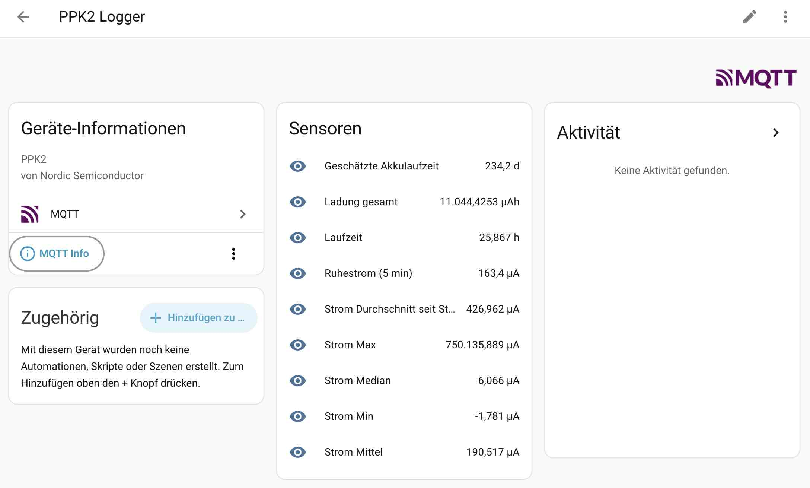
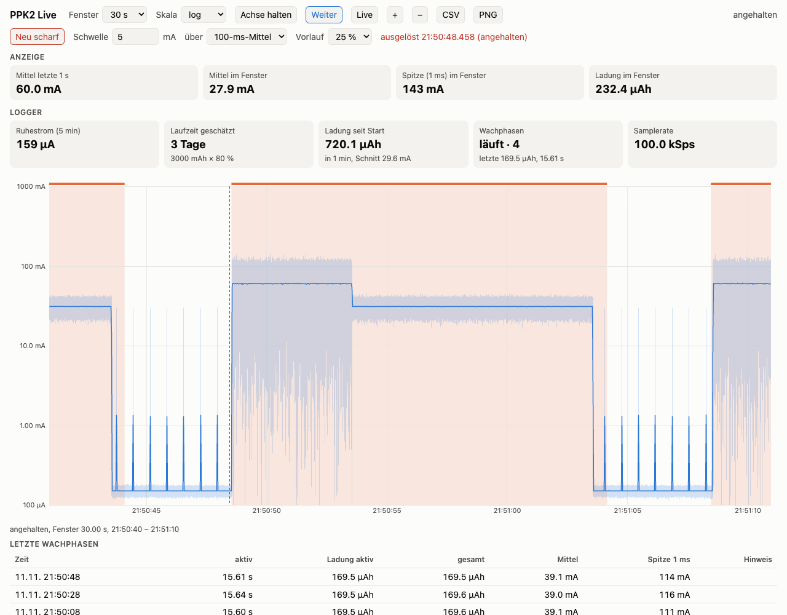
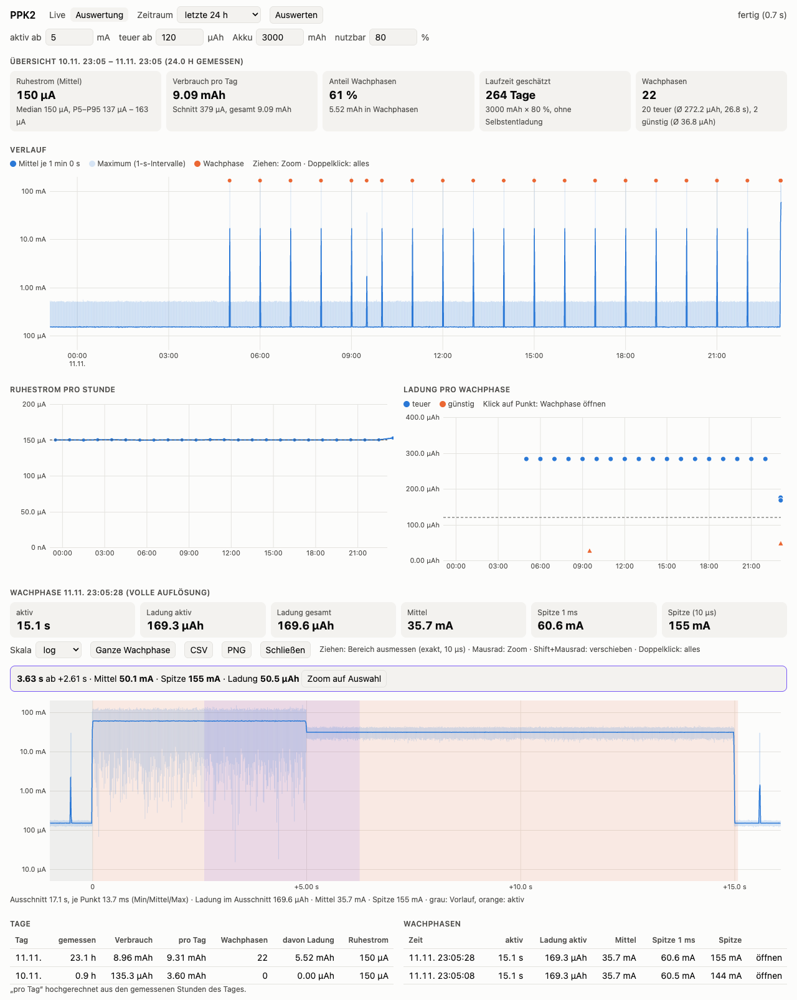

<p align="center">
  <a href="https://docbigs-lab.de">
    
  </a>
</p>
<p align="center">
  <a href="https://docbigs-lab.de">https://docbigs-lab.de</a>
</p>

# PPK2 Longterm Logger

Langzeitmessungen mit dem **Nordic Power Profiler Kit II (PPK2)** auf einem Raspberry Pi, ohne dass ein PC mitlaufen muss. Läuft als Docker-Container, schreibt Statistik-CSVs, meldet den Stand an **Home Assistant** (MQTT) und zeigt den Strom auf Wunsch live im Browser.

*English in short: Docker-based long-term logger for the Nordic PPK2 on a Raspberry Pi. Condenses 100 kSps into per-interval statistics (mean/min/max/median/charge), writes daily CSV files, optionally publishes to Home Assistant via MQTT discovery (incl. a rolling quiet-current sensor and battery-life estimate). Optional: every wake-up saved at full 100 kSps, and a live browser view (1 ms min/max/mean envelope, measure/zoom, oscilloscope-style trigger, CSV/PNG export) while logging continues. Includes analysis scripts for sleep current, wake-ups and battery lifetime. README is in German.*

Entstanden beim Messen eines ESP32-C6-E-Paper-Displays im Deep Sleep, aber nicht darauf beschränkt: alles, was Strom zieht und sich über Tage beobachten lassen soll.

## Was es kann

- **Dauerbetrieb über Tage**: 100.000 Samples pro Sekunde werden fortlaufend zu einem Datensatz pro Intervall verdichtet (Mittel, Min, Max, Median, Samplezahl, Gesamtladung). Das Dekodieren läuft in numpy, einschließlich des Spike-Filters der Bibliothek. Auf einem Raspberry Pi 4 kommen die vollen 100 kSps lückenlos an, auch wenn das PPK2 über 10 000-mal pro Sekunde den Messbereich wechselt.
- **PPK2 automatisch finden**: Das PPK2 legt zwei serielle Ports an. Der Logger nimmt den Datenport und ignoriert die Shell, auch wenn sich die Nummern nach dem Umstecken ändern.
- **Stream-Wiederherstellung**: Läuft das PPK2 nach einem Absturz oder Neustart noch im Messmodus, wird der alte Datenstrom gestoppt und die Kalibrierung sauber geladen.
- **Ampere- und Source-Modus**: externe Versorgung durchmessen oder das Testobjekt direkt vom PPK2 versorgen.
- **Home Assistant per MQTT-Discovery**: die Sensoren legen sich selbst an, ohne YAML.
- **Akkulaufzeit-Schätzung** aus dem Durchschnitt seit Start.
- **Ruhestrom-Sensor**: gleitender Mittelwert nur über „ruhige“ Intervalle, damit Wachphasen den Wert nicht verfälschen. Ideal, um Hardware-Umbauten live vorher/nachher zu vergleichen.
- **`analyse.py`**: wertet die CSVs aus (Ruhestrom pro Stunde, Wachphasen, Tagesbilanz, Laufzeit), auf Wunsch als Diagramm.
- **Wachphasen in voller Auflösung** (optional): Jede Wachphase wird mit 100 kSps samt Vorlauf gespeichert, `wake_view.py` zeigt Verlauf, Spitzen und Ladung (siehe [unten](#wachphasen-in-voller-auflösung)).
- **Live-Ansicht im Browser** (optional): Hüllkurve mit 1 ms Auflösung, Bereiche ausmessen, Trigger wie am Oszilloskop, Export als CSV und PNG, während der Logger weiter misst (siehe [unten](#live-ansicht-im-browser)).
- **Auswertung im Browser** (mit der Live-Ansicht): Zeitraum wählen, Ruhestrom, Wachphasen, Tagesbilanz und Laufzeit als Diagramme, jede Wachphase bis auf einzelne Samples zoomen (siehe [unten](#auswertung-im-browser)).
- **`diag.py`**: prüft, ob alle Samples ankommen, und schneidet Rohdaten mit (siehe [Diagnose](#diagnose)).

## Aufbau

Beispiel für den Ampere-Modus mit Akku (der Prüfling wird durch das PPK2 „durchgereicht“):

```
Akku (+) ──► PPK2 VIN        PPK2 VOUT ──► Prüfling (+)
Akku (−) ──► PPK2 GND ───────────────────► Prüfling (−)
                   │
                   └─ USB ──► Raspberry Pi (Docker)
```

Im Source-Modus (`PPK2_MODE=source`) versorgt das PPK2 den Prüfling selbst mit der eingestellten Spannung.

## Schnellstart

Voraussetzung: Raspberry Pi mit Docker und Docker Compose, PPK2 per USB.

```bash
git clone https://github.com/DocBigs-Lab/ppk2-longterm-logger.git
cd ppk2-longterm-logger
cp .env.example .env      # anpassen, vor allem PPK2_MODE und optional MQTT
docker compose up -d
docker logs -f ppk2-logger
```

Im Log siehst du den verwendeten Port, „Kalibrierdaten geladen: True“ und „Messung gestartet“. Die Daten landen in `./data/ppk2_JJJJ-MM-TT.csv` (ein Tag pro Datei, Zeitstempel in UTC).

Statt des fertigen Images kannst du auch selbst bauen: in `docker-compose.yml` die Zeile `image` auskommentieren, `build: .` einkommentieren und mit `docker compose up -d --build` starten. Nach jeder Änderung an den Skripten ist ein Neubau nötig (`--build --force-recreate`).

## Konfiguration (`.env`)

| Variable | Standard | Bedeutung |
|---|---|---|
| `PPK2_MODE` | `source` | `source` = PPK2 versorgt den Prüfling, `ampere` = nur Strommessung |
| `PPK2_VOLTAGE_MV` | `3300` | Spannung in mV, im Ampere-Modus der Wert für die Berechnung |
| `PPK2_PORT` | leer | leer = automatisch suchen, sonst z. B. `/dev/ttyACM0` |
| `LOG_INTERVAL_S` | `1` | Intervall der Statistik in Sekunden |
| `OUT_DIR` | `/data` | Ordner der CSV-Dateien im Container |
| `BATTERY_MAH` | `3000` | Akkukapazität für die Laufzeitschätzung |
| `BATTERY_USABLE` | `0.8` | nutzbarer Anteil der Kapazität |
| `MQTT_HOST` | leer | leer = MQTT aus |
| `MQTT_PORT`, `MQTT_USER`, `MQTT_PASS` | `1883`, leer, leer | Zugang zum Broker |
| `MQTT_TOPIC` | `ppk2/stats` | Topic der Zustandsmeldungen |
| `ROLL_WINDOW_S` | `300` | Fenster des Ruhestrom-Sensors in Sekunden |
| `QUIET_MAX_UA` | `5000` | Intervalle mit einem Mittelwert darüber zählen als „aktiv“ |
| `WAKE_CAPTURE` | `0` | `1` = Wachphasen in voller Auflösung speichern |
| `WAKE_TRIGGER_UA` | leer | Schwelle für das gleitende Mittel in µA, leer = `QUIET_MAX_UA` |
| `WAKE_TRIGGER_MS` | `100` | Fenster des gleitenden Mittels für den Trigger in ms |
| `WAKE_PRE_S`, `WAKE_POST_S` | `2`, `2` | Vorlauf und Nachlauf in Sekunden. Der Nachlauf ist auch die Ruhezeit, nach der eine Wachphase als beendet gilt |
| `WAKE_MAX_S` | `120` | Höchstdauer einer Aufnahme in Sekunden |
| `WAKE_MAX_MB` | `2000` | Obergrenze für `data/wake`, älteste Dateien werden gelöscht |
| `WAKE_MIN_FREE_MB` | `500` | darunter wird nicht mehr gespeichert |
| `LIVE_PORT` | leer | Port der Live-Ansicht und Auswertung im Container, leer = aus |
| `LIVE_HISTORY_S` | `120` | so viele Sekunden hält der Logger für die Live-Ansicht vor (ca. 1,4 MB bei 120 s) |

Kommentare in der `.env` gehören in eigene Zeilen. Docker liest sie sonst als Teil des Werts, aus `MQTT_TOPIC=ppk2/stats # Topic` wird ein ungültiges Topic.

## Home Assistant

Mit gesetztem `MQTT_HOST` meldet sich der Logger per Discovery als Gerät „PPK2 Logger“ und legt diese Sensoren an:

- Strom Mittel, Median, Min, Max (µA, pro Intervall)
- **Ruhestrom (5 min)** (µA, gleitend über ruhige Intervalle, braucht etwa 30 s Ruhe bis zum ersten Wert)
- Ladung gesamt (µAh)
- Strom Durchschnitt seit Start (µA)
- Laufzeit (h)
- Geschätzte Akkulaufzeit (Tage)
- mit `WAKE_CAPTURE=1` zusätzlich: Letzte Wachphase Ladung (µAh) und Dauer (s), Wachphasen seit Start



## Auswertung

Die CSV enthält pro Intervall `timestamp_utc, mean_uA, min_uA, max_uA, samples, charge_uAh_total, median_uA`. Für eine Zusammenfassung läuft `analyse.py` direkt auf dem Pi, nur mit Python 3 (dasselbe mit Diagrammen im Browser: [Auswertung im Browser](#auswertung-im-browser)):

```bash
python3 analyse.py                          # letzte 24 h
python3 analyse.py --hours 12
python3 analyse.py --von 2026-11-07T10:30   # ab Zeitpunkt (UTC)
python3 analyse.py --raster 1800            # Abweichung der Wachphasen von :00/:30
python3 analyse.py --hours 72 --png verlauf.png   # zusätzlich Diagramm
```

Ausgegeben werden Ruhestrom (Mittel und pro Stunde), eine Liste der Wachphasen mit Dauer und Ladung, die Tagesbilanz und die hochgerechnete Akkulaufzeit. Einstellbar sind unter anderem `--aktiv` (Schwelle für Wachphasen in µA), `--mah`, `--nutzbar`, `--tz` (Ortszeit-Offset) und `--redraw-uah` (ab welcher Ladung eine Wachphase als „teuer“ gilt).

`--png` zeichnet zwei Diagramme mit gemeinsamer Zeitachse: Ruhestrom pro Stunde und Ladung jeder Wachphase (teuer/günstig, Schwelle gestrichelt). Dafür braucht es matplotlib, auf dem Pi z. B. `sudo apt install python3-matplotlib`. Ohne `--png` bleibt es bei der Standardbibliothek. `data/` gehört dem Container (root), das Diagramm deshalb z. B. nach `~/verlauf.png` schreiben.

## Wachphasen in voller Auflösung

Mit `WAKE_CAPTURE=1` hält der Logger die letzten Sekunden in einem Ringpuffer. Steigt der über 100 ms gemittelte Strom über die Schwelle, wird aufgezeichnet, bis er `WAKE_POST_S` Sekunden lang darunter bleibt. Kurze Einbrüche, etwa zwischen WLAN und Display-Refresh, beenden die Aufnahme nicht.

Das lange Fenster ist Absicht: Der Ruhestrom vieler Schaltungen besteht aus kurzen Pulsen (Spannungswandler im Pulsbetrieb). Am ESP32-C6-Display erreichen sie im 1-ms-Mittel bis ca. 30 mA, im 100-ms-Mittel unter 1 mA. Eine Wachphase liegt dagegen auch im 100-ms-Mittel weit über 100 mA. Mit 1 ms löst jeder Puls aus und die Aufnahme endet nie.

- Dateien: `data/wake/JJJJ-MM-TT/wake_JJJJMMTTTHHMMSSZ.npz` (UTC), Inhalt `uA` (float32, 10 µs pro Sample) und `meta` (JSON mit Startzeit, Vorlauf, Schwelle, Ladung usw.)
- Übersicht: `data/wake/wake_index.csv`, eine Zeile pro Wachphase, auch für verworfene
- Größe: gemessen etwa 4:1 komprimiert, ca. 3 MB pro 30-s-Wachphase. Bei 18 Wachphasen am Tag sind das ca. 55 MB, 2000 MB reichen für gut einen Monat. Danach werden die ältesten Dateien gelöscht, der Index bleibt.
- Gespeichert wird in einem eigenen Thread. Ist er noch belegt oder der Platz knapp, wird die Wachphase verworfen und im Index vermerkt. Die Messung läuft in jedem Fall weiter, ein Fehler in der Aufnahme schaltet nur die Aufnahme ab.
- Ein Dauerstrom (z. B. Laden) wird nach `WAKE_MAX_S` abgeschnitten, danach wartet der Recorder, bis es wieder ruhig ist.

Auswertung mit `wake_view.py`. Liste und `--tage` laufen überall, Verlauf und `--csv` brauchen numpy. Am einfachsten im Container:

```bash
docker exec ppk2-logger python wake_view.py                   # letzte 20 Wachphasen
docker exec ppk2-logger python wake_view.py --tage 7          # Summe und Mittel pro Tag
docker exec ppk2-logger python wake_view.py letzte            # Verlauf der letzten Wachphase im 1-s-Raster
docker exec ppk2-logger python wake_view.py letzte --raster 0.2
docker exec ppk2-logger python wake_view.py 2026-11-09/wake_20261109T050012Z.npz --csv /data/phase.csv --bucket-ms 1
```

`--csv` schreibt Min/Mittel/Max pro Raster, `--png` ein Diagramm. Dafür braucht es matplotlib, das im Image fehlt: entweder auf dem PC (`python3 wake_view.py --dir ./data letzte --png phase.png`) oder vorübergehend im laufenden Container (`docker exec ppk2-logger pip install matplotlib`, kein Neustart, nach einem Neubau wieder weg).

Grenzen: Die Zeitstempel sind auf etwa 0,1 s genau (Blockgröße der Bibliothek). Der Recorder misst die effektive Rate seit Start (`rate_eff` in den Metadaten) und rechnet Dauer, Zeitachse und µAh damit. Vorlauf, Nachlauf und Höchstdauer sind in Samples bemessen. Die Werte enthalten den Spike-Filter der Bibliothek wie die Statistik auch. Aufnahmen aus älteren Versionen (vor dem neuen Dekoder, siehe [Grenzen](#grenzen)) haben nur ca. 88 kSps, `rate_eff` gleicht das aus.

## Live-Ansicht im Browser

Der Logger kann den Strom live im Browser zeigen, während er weiter misst und aufzeichnet. Er bleibt dabei einziger Besitzer des PPK2. Zu sehen ist je Millisekunde Min, Max und Mittel (Hüllkurve) der letzten 2 Minuten, linear oder logarithmisch, mit Uhrzeit-Achse.

- **Ausmessen und Zoom**: Bereich mit der Maus ziehen zeigt Dauer, Mittel, Min, Spitze (1 ms) und Ladung. Mausrad zoomt, Shift+Mausrad verschiebt, Doppelklick führt zurück zu live, „Zoom auf Auswahl“ vergrößert den markierten Bereich.
- **Trigger wie am Oszilloskop**: hält an, sobald der Strom über eine Schwelle steigt (100-ms-Mittel oder 1-ms-Spitze, Flanke), mit wählbarem Vorlauf (10/25/50 % des Fensters). So lässt sich die nächste Wachphase abfangen, ohne davorzusitzen.
- **Wachphasen**: erfasste Wachphasen (`WAKE_CAPTURE=1`) erscheinen als Band im Verlauf und als Tabelle (Zeit, aktive Dauer, Ladung, Mittel, Spitze). Ein Klick auf eine Zeile springt zur Wachphase, solange sie in den letzten 2 Minuten liegt. Eine laufende Wachphase ist markiert.
- **Kennzahlen des Loggers** wie in Home Assistant: Ruhestrom, geschätzte Laufzeit, Ladung seit Start, Wachphasen, Samplerate.
- **Export**: angezeigter Ausschnitt oder Auswahl als CSV (1-ms-Werte) oder PNG.

Die y-Achse passt sich ruhig an (sofort größer, erst nach 3 s Ruhe wieder kleiner) und lässt sich mit „Achse halten“ festsetzen. Die Auflösung ist 1 ms. Einzelne Pulse in voller Auflösung (10 µs) stehen in den Wachphasen-Dateien.



Einschalten: in `.env` `LIVE_PORT=8080` setzen, in `docker-compose.yml` den Abschnitt `ports` einkommentieren und den Container neu starten (der Prüfling verliert dabei kurz die Versorgung). Danach `http://<Pi>:8080/` öffnen.

Der Webserver nutzt nur die Python-Standardbibliothek (Server-Sent Events), bis zu 4 Browser gleichzeitig, ca. 25 kB/s je Browser. Am Raspberry Pi 4 kostet die Live-Ansicht etwa 2 % eines Kerns, die Samplerate bleibt bei 100 kSps. Fällt sie aus, läuft die Messung weiter. Es gibt keine Anmeldung, die Seite gehört nur ins Heimnetz.

Ohne PPK2 zeigt `python3 live_view.py --demo` die Seite mit simulierten Daten unter `http://127.0.0.1:8080/` (braucht numpy). Die Demo erzeugt vorab 48 h Verlauf mit Wachphasen, die Auswertung unter `/auswertung` ist nach ca. 50 s vollständig. Wer nur die Seiten `live_view.html` oder `auswertung.html` ändert, kann sie einzeln mit `docker cp live_view.html ppk2-logger:/app/` bzw. `docker cp auswertung.html ppk2-logger:/app/` in den laufenden Container kopieren, sie werden bei jedem Aufruf neu gelesen. Ein Neustart und damit ein Stromausfall am Prüfling ist dafür nicht nötig.

### Auswertung im Browser

Unter `http://<Pi>:8080/auswertung` (Reiter „Auswertung“ oben auf der Live-Seite) zeigt der Logger dasselbe wie `analyse.py` und `wake_view.py`, ohne Kommandozeile:

- Zeitraum 24 h, 48 h, 7 oder 30 Tage oder ab einem Zeitpunkt, dazu Schwelle für Wachphasen, Schwelle „teuer“, Akkukapazität und nutzbarer Anteil. Zeiten in der Zeitzone des Browsers.
- Kacheln mit Ruhestrom (Mittel, Median, P5–P95), Tagesverbrauch, Laufzeit und Wachphasen.
- Diagramme: Verlauf (Mittel und Max je Intervall, logarithmisch, Zoom durch Ziehen), Ruhestrom pro Stunde, Ladung pro Wachphase. Ein Klick auf eine Wachphase öffnet ihre Aufnahme.
- Wachphase in voller Auflösung (`WAKE_CAPTURE=1`): Mausrad zoomt bis auf einzelne Samples (10 µs), eine Auswahl wird exakt aus den Rohdaten ausgemessen (Dauer, Mittel, Spitze, Ladung). Export als CSV oder PNG.
- Tabellen pro Tag und pro Wachphase.



Gerechnet wird in eigenen Prozessen mit niedriger Priorität (`nice 10`): `analyse.py --json` pro Abruf (Ergebnis 60 s zwischengespeichert), `wake_view.py --serve` dauerhaft für die Wachphasen (hält die letzten 3 Aufnahmen im Speicher). So rechnen sie nicht im Logger-Prozess und bremsen den Lese-Thread nicht aus. Gelesen werden nur Dateien unter `data/`.

## Tests ohne Hardware

`tests/` enthält eine Simulation (synthetische Wachphasen, Fake-PPK2) für Recorder, Logger-Schleife, Live-Ansicht, Auswertung im Browser und `wake_view.py`:

```bash
pip install numpy ppk2-api==0.9.2
python3 -m unittest discover tests
```

`tests/test_decoder.py` vergleicht den Dekoder (`ppk2_fast.py`) mit `PPK2_API.get_samples()` der Bibliothek, mit synthetischen Rohwörtern (inkl. Bereichswechseln, Spike-Filter und Fenstern über Blockgrenzen) und mit echten Rohbytes aus `tests/daten/` (Mitschnitt mit `diag.py --raw` am Pi 4, siehe unten). Auf den kompletten 60-s-Mitschnitten weicht er höchstens 2·10⁻¹⁰ µA von der Bibliothek ab.

## Diagnose

`diag.py` zeigt, was vom PPK2 wirklich ankommt, und kann die Rohbytes mitschneiden. Das PPK2 kann nur ein Programm gleichzeitig nutzen, der Logger muss dafür gestoppt sein. **Der Prüfling verliert dabei die Versorgung.**

```bash
docker compose stop ppk2-logger
docker compose run --rm ppk2-logger python diag.py --sekunden 60 --raw /data/roh_mp.bin
docker compose run --rm ppk2-logger python diag.py --sekunden 60 --raw /data/roh_direkt.bin --direkt
docker compose start ppk2-logger
```

Enthält das Image `diag.py` noch nicht (ältere Images oder ein Neubau steht aus), das Skript aus dem Checkout einbinden: `docker compose run --rm -v "$PWD/diag.py:/app/diag.py:ro" ppk2-logger python diag.py ...`

Ohne `--direkt` liest `diag.py` wie der Logger über `PPK2_MP` (Lese-Thread der Bibliothek), mit `--direkt` ohne Thread direkt vom Port. Die Auswertung nutzt den 6-Bit-Zähler in Bit 18–23 jedes Samples: Sprünge zeigen fehlende Samples, Sprünge auf den 40 000-Byte-Blockgrenzen von `PPK2_MP` verworfene Blöcke. `python3 diag.py --auswerten data/roh_mp.bin` wertet einen Mitschnitt später erneut aus, ohne PPK2.

Ein Stück Mitschnitt als Testdaten für den Dekoder (ca. 1 s, 400 kB):

```bash
head -c 400000 data/roh_mp.bin > tests/daten/pi4_ruhe.bin && cp data/roh_mp.json tests/daten/pi4_ruhe.json
```

## Bekannte Stolperfallen

- **Zwei Ports, nur einer zählt.** Der niedrigere ttyACM ist der Datenport, der höhere die Zephyr-Shell. Mit `PPK2_PORT` leer wählt der Logger den richtigen.
- **Im Ampere-Modus liefert VOUT nur Spannung, wenn die Ausgabe eingeschaltet ist.** Der Logger schaltet sie ein. Ohne das bleibt der Prüfling stromlos, obwohl VIN anliegt.
- **Ein Neustart des Containers trennt den Prüfling kurz von der Versorgung.** Wird die serielle Verbindung geschlossen, geht VOUT aus. Der Prüfling bootet danach neu. Das gilt auch bei einem Absturz.
- **Median und Maximum sind kein Ruhestrom.** Bei gepulsten Strömen (Ladeschaltungen, Wandler) liegt der Median nahe Null, obwohl der Mittelwert hoch ist. Aussagekräftig ist nur der Mittelwert über längere Fenster.
- **Docker-Rechte**: Der Container bekommt `/dev` und eine cgroup-Regel für ttyACM (Major 166), damit ein neu enumerierter Port weiter funktioniert.

## Beispielmessung

ESP32-C6 mit E-Paper, 3000-mAh-Akku, von 5 bis 22 Uhr stündlich ein Aufwachen (18 pro Tag: WLAN, Wetterabruf, Display-Refresh):

| | vor Umbau | nach Umbau (erste Messung) | nach Umbau (24 h 10./11.11., `analyse.py`) |
|---|---|---|---|
| Ruhestrom im Deep Sleep | ca. 1390 µA | ca. 156 µA | 149 µA (P5 94, P95 213) |
| Wachphase mit Refresh | ca. 310 µAh, 30 s | ca. 310 µAh, 30 s | Mittel 199 µAh, 27–33 s |
| Tagesverbrauch | ca. 37 mAh | ca. 9,5 mAh | 7,1 mAh, davon 50 % Wachphasen |
| geschätzte Laufzeit | ca. 65 Tage | ca. 250 Tage | ca. 337 Tage |

Der Umbau war ein ausgelöteter Pull-up an der BUSY-Leitung des Displays. Die Laufzeit rechnet mit 80 % der Nennkapazität und ohne Selbstentladung des Akkus.

Die 24-h-Messung (09./10.11.) zeigt 18 Wachphasen zwischen 170 und 225 µAh, dazu zwei Ausreißer mit 262 und 398 µAh bei 38 s. Die Wachphasen-Aufnahme ergibt für dieselben 18 Wachphasen 3760 µAh, `analyse.py` 3770 µAh. Eine Wachphase ohne Display-Refresh kostet ca. 100 µAh in 8 s. Der Rückgang von ca. 310 auf ca. 190 µAh pro Wachphase zwischen erster Messung und 24-h-Messung fällt mit einem Update der Display-Firmware am 09.11. zusammen, nicht mit dem Umbau.

In der zweiten 24-h-Messung (10./11.11.) hat das Display in allen 18 Wachphasen neu gezeichnet (163–273 µAh). Das ist kein Fehler: Die Anzeige enthält die aktuelle Temperatur, und die ändert sich fast jede Stunde. Wachphasen ohne Neuzeichnen (ca. 100 µAh) kämen auf ca. 450 Tage, das wurde bewusst nicht weiter verfolgt.

In der Live-Ansicht zeigt sich, woraus der Ruhestrom besteht: Die Grundlinie liegt bei etwa 1–10 µA, dazu kommt etwa alle 5 ms ein Puls, der im 1-ms-Mittel 10–60 mA erreicht, vermutlich vom Spannungswandler im Burst-Betrieb. Die rund 150 µA Ruhestrom entstehen fast ganz aus diesen Pulsen.

## Grenzen

- Die Statistik pro Intervall zeigt keine einzelnen Stromspitzen. Dafür gibt es die Live-Ansicht (1 ms), die Wachphasen-Aufnahme (`WAKE_CAPTURE`, 10 µs) oder die Nordic-App.
- Bis Version 11/2026 kamen am Raspberry Pi 4 nur ca. 88.000 statt 100.000 Samples pro Sekunde an. Ursache (geklärt mit `diag.py`): Bei gepulstem Strom wechselt das PPK2 ca. 11 000-mal pro Sekunde den Messbereich, fast jeder Block lief durch die langsame Python-Schleife der Bibliothek, der Lese-Thread kam zu selten dran und das PPK2 sendete weniger. Seit der Spike-Filter im Dekoder vektorisiert ist, entfällt diese Last: am selben Pi kommen jetzt im Mittel 100 333 Samples pro 1-s-Zeile an. Mittelwert und Ladung waren auch vorher richtig (Mittel × Zeit).
- Der Container belegt am Pi 4 etwa einen Kern, auch ohne Browser. Das kommt vom Lese-Thread der Bibliothek, der den Port in einer engen Schleife abfragt. Für die Messung ist das kein Problem, der Pi hat vier Kerne.
- Die Laufzeit ist eine Hochrechnung aus dem bisherigen Durchschnitt und braucht mindestens einen vollständigen Zyklus des Prüflings.
- Getestet mit PPK2, `ppk2-api-python` 0.9.2 auf einem Raspberry Pi. Die Bibliotheksversion ist im Dockerfile festgenagelt, weil `ppk2_fast.py` interne Zustände der Bibliothek mitführt.

## Siehe auch

- [ppk2.html](https://github.com/pilate/ppk2.html) von pilate: eine einzelne HTML-Seite, die das PPK2 per Web Serial direkt im Browser ausliest, ohne Installation. Sie zeigt die vollen 100 kHz statt der 1-ms-Werte der Live-Ansicht hier und taugt damit für den Blick auf einzelne Pulse. Für Messungen über Tage ist sie nicht gedacht, weil sie die Aufnahme im Speicher hält. Beide können nicht gleichzeitig auf das PPK2 zugreifen: Vor dem Einsatz der Seite den Container stoppen (`docker compose stop`) und danach wieder starten. Der Prüfling verliert dabei kurz die Versorgung.

## Lizenz

GPL-2.0-only, siehe [LICENSE](LICENSE). Das Projekt nutzt und erweitert [`ppk2-api-python`](https://github.com/IRNAS/ppk2-api-python) von IRNAS (GPL-2.0), `ppk2_fast.py` bildet deren Dekodierung nach. Das PPK2 ist ein Produkt von Nordic Semiconductor, dieses Projekt steht in keiner Verbindung zu Nordic.

Ein Projekt von [DocBigsLab](https://docbigs-lab.de) – entwickelt, nicht gebastelt.
